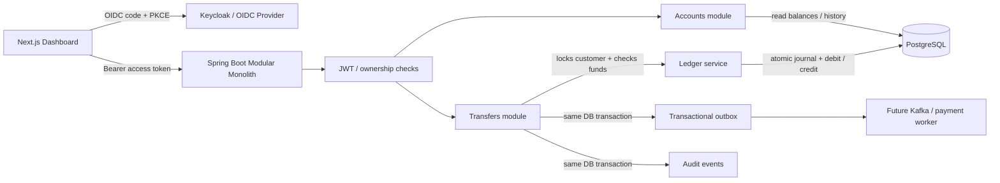

# FINIX — Core Banking Platform (starter)

A responsive banking dashboard inspired by the supplied FINIX reference, plus a **ledger-backed modular-monolith API** for customer accounts, OIDC authentication, account history, internal transfers, and append-only audit records.

> **Scope:** This is an educational engineering starter / secure sandbox, **not** a licensed or production-ready bank. All preview figures, the development identity, seeded accounts, goals and watchlist are fictional. No external payments or real investment trading are implemented.

Open **`preview.html`** directly in any browser to inspect the standalone visual mockup (no dependencies). It deliberately uses sample data and never calls the banking API.

## What is included

| Layer | Implementation |
| --- | --- |
| Frontend | Next.js 16 App Router, React 19, strict TypeScript, Tailwind CSS 4, Radix-based shadcn-style components, Motion, Recharts, TanStack Query/Table, React Hook Form + Zod, next-themes |
| Backend | Java 21, Spring Boot 3.5, Spring Security, REST |
| Identity | Keycloak OIDC/OAuth 2.0 Authorization Code + PKCE for local development; JWT access-token validation on API |
| Financial storage | PostgreSQL 16, Flyway, integer minor units; immutable double-entry ledger |
| Messaging | Atomic transactional outbox persistence; external dispatcher not yet supplied |
| Testing | JUnit 5 + Testcontainers integration tests; Playwright UI smoke tests |
| API reference | OpenAPI / Swagger UI |
| Infra | Dockerfiles, Docker Compose development dependencies, initial AWS ECR/CloudWatch Terraform resources |
| CI/CD | GitHub Actions builds + integration/UI tests |
| Monitoring | Actuator + Prometheus metrics; optional Prometheus and Grafana containers; OTel agent hook described below |

## Architecture



**Ledger is authoritative.** There is no mutable `balance` column. An account's balance is `SUM(ledger_entries.amount_minor)` in that account's currency. Each committed journal must have at least two nonzero entries, one currency, and a zero sum; deferred database triggers validate this at commit. Ledger journals, entries, transfers and audit events reject UPDATE/DELETE through database triggers. (Database administrators can still bypass such controls; truly tamper-evident, regulator-grade evidence storage needs an additional independent mechanism.)

**Transfer consistency.** A transfer holds a PostgreSQL row lock on the owning customer, validates both accounts belong to that subject, checks currency/active status and sufficient funds, then writes the journal, debit and credit, transfer receipt, audit event and outbox event in **one database transaction**. The per-customer lock serializes concurrent transfers for this demo; for scaled cross-customer transfers, use an ordered-account-locking strategy and capacity testing. The `Idempotency-Key` is scoped to the customer and bound to the transfer payload. Repeating it returns the same receipt without reposting funds; reusing it for different details produces HTTP 409.

### Source layout

```
frontend/               Next.js dashboard, OIDC sign-in, transfer form, UI tests
backend/src/main/java/
  com/finix/banking/
    accounts/            Customer ownership, account balances
    ledger/              Only service that posts journals
    transfers/           Transactional transfer orchestration
    api/                 Dashboard, transfers, audit HTTP endpoints
    config/              JWT and API docs
backend/src/main/resources/db/
  migration/             Production schema only
  demo/                  Explicit dev-profile-only fictional seed data
infra/keycloak/          OIDC dev realm
infra/observability/     Prometheus and Grafana configs
infra/terraform/         Initial AWS container repositories/log group
.github/workflows/       CI
```

## Run locally

Requirements: **Java 21, Maven 3.9+, Node.js 22, npm, Docker Compose.** The database and OIDC identity provider start in containers; the API and web app run locally. Make sure ports **3000, 5432, 8080 and 8081** are free.

```bash
# 1. From the repository root: development dependencies
 docker compose up -d postgres keycloak

# 2. In one terminal: banking API (Flyway also loads fictional demo data)
 cd backend
 mvn spring-boot:run -Dspring-boot.run.profiles=dev

# 3. In another terminal: dashboard
 cd frontend
 cp .env.example .env.local
 npm install
 npm run dev
```

Visit **http://localhost:3000** to see the responsive FINIX demo. The default page is explicitly marked **INTERACTIVE DEMO**; nothing posted from the preview transfers funds. To test actual sandbox API posting, click **Sign in** and use the fictional Keycloak user:

- Username: `alex`
- Password: `DemoPass123!`
- Realm: `finix` (Keycloak at http://localhost:8081)

The development data has two GBP accounts ending in **4568** and **0958** with combined balance **£10,524.15**. A secure transfer moves pence from one account to the other without changing the combined balance. Transaction history and monthly income/expense numbers in the signed-in view are queried from the ledger. The savings-goal component is a **UI preview only**; its figures are never represented as ledger-backed. The investments watchlist shows real provider quotes (see below) or nothing.

Keycloak admin console for local debugging: `http://localhost:8081/admin` (`admin` / `dev_admin_only`). Do not reuse these development passwords.

### Currency (GBP)

FINIX is a **British pound sterling (GBP, £)** platform: `en-GB` formatting, `Europe/London` display time, amounts stored and calculated as **integer pence** (100p = £1). `formatGBP`/`money` in `frontend/lib/utils/format.ts` are display-only. The API rejects any non-GBP account or posting (`Currencies`, `LedgerService`, `TransferService`; cross-currency transfers are refused), and migration `V3` makes the database default new accounts to GBP and reject non-GBP ones. The dev seed is fictional GBP data.

**Existing USD dev data is never relabelled.** A local database seeded earlier with USD data fails Flyway's checksum on the edited seed; reset it with `scripts/reset-dev-db.sh` (deletes the local volume and reseeds GBP opening-balance journals). Converting real USD balances would need an approved conversion with a documented exchange rate and reconciliation, which this repo does not implement.

### API

| Method | Path | Description |
| --- | --- | --- |
| GET | `/api/dashboard` | Signed-in customer's balances, account cards, 50 latest ledger entries and monthly metrics |
| GET | `/api/accounts` | Owned active accounts with ledger-derived balances |
| GET | `/api/transfers` | Customer's latest 50 committed transfers (same shape as the POST receipt) |
| GET | `/api/transactions` | Customer's latest 50 ledger entries |
| POST | `/api/transfers` | Transfer between customer's own active same-currency accounts; requires `Idempotency-Key` header |
| GET | `/api/events/stream` | Server-Sent Events: `dashboard.updated` invalidation notices for the signed-in customer (Bearer header only) |
| GET | `/api/audit` | Customer's latest posted transfer audit events |
| GET | `/actuator/health` | Public health check |
| GET | `/actuator/prometheus` | Metrics; protect with network policy in a real deployment |
| GET | `/swagger-ui.html` | API explorer; protect in a real deployment |

Example authenticated transfer (use the OIDC access token returned by Keycloak; **do not** use an ID token as an API credential):

```bash
curl -X POST http://localhost:8080/api/transfers \
  -H "Authorization: Bearer $ACCESS_TOKEN" \
  -H "Content-Type: application/json" \
  -H "Idempotency-Key: example-transfer-0001" \
  -d '{
    "sourceAccountId":"11111111-1111-4111-8111-111111111111",
    "destinationAccountId":"22222222-2222-4222-8222-222222222222",
    "amountMinor":3540,
    "description":"Move into savings"
  }'
```

### Market data and paper trading (investments)

The **Investments** page and the dashboard watchlist show real quotes for AAPL, MSFT, NVDA and NFLX from [Twelve Data](https://twelvedata.com), fetched **by the Spring Boot API** (`backend/.../market`). The browser only talks to FINIX; the provider key never reaches client-side code. Without a key no prices are shown at all (there is no sample market data).

**Set up**

1. Create a free Twelve Data key at https://twelvedata.com (Basic plan: 8 API credits per minute, 800 per day).
2. Put it in the **backend** environment: `export TWELVE_DATA_API_KEY=...` before `mvn spring-boot:run`, or copy `.env.example` to `.env` (git-ignored). With Docker use `docker run --env-file .env -p 8080:8080 <backend-image>` (the Dockerfile contains no secrets; configuration is read at runtime). Do not use `NEXT_PUBLIC_*` for any of these.
3. Only if your plan includes real-time US data, also set `MARKET_DATA_REALTIME_ENTITLED=true`. The provider's quote response has no entitlement flag, so FINIX will not say **Live** unless you confirm this *and* the market is open *and* the quote timestamp is recent. Otherwise open-market quotes are labelled **Delayed**, closed-market quotes **End of day**, and quotes served from cache after a provider failure **Stale**.

| Method | Path | Description |
| --- | --- | --- |
| GET | `/api/market/quotes?symbols=AAPL,MSFT,NVDA,NFLX` | Quotes (native currency), freshness label, market status, indicative GBP estimate. Per-symbol failures are returned as `errors[]`, never as invented prices |
| GET | `/api/market/quotes/{symbol}` | One quote; structured `{code, message, retryAfterSeconds}` errors |
| GET | `/api/market/history/{symbol}?range=1D\|1W\|1M\|3M\|1Y` | Price history, oldest to newest, with exchange timezone |
| GET | `/api/market/status` | Provider configured?, credits remaining this minute, last success/error (no secrets) |
| GET | `/api/market/events` | SSE `market.updated` hints (no prices; clients re-read the REST endpoints). Authenticated by Bearer header only |

All endpoints require the same OIDC access token as the banking API. Symbols are validated against a server-side allow-list; nothing else reaches the provider.

**How the provider is used safely.** `TwelveDataClient` sends the key in the `Authorization: apikey …` header (never in a URL), with request timeouts, retry with exponential backoff for transient failures, and a per-minute credit limiter (default 8). Errors are detected from both the HTTP status and Twelve Data's documented `{code, message, status:"error"}` body (the docs do not say which HTTP status accompanies it); provider error text is never forwarded. `MarketDataService` caches (quotes 60 s while the market is open, 15 min when closed; history 15 min; FX 10 min) and **coalesces** concurrent requests into one provider call. If the provider fails, the last good value is served flagged **stale**; if there is none, the symbol shows "Price unavailable". Each symbol is fetched with its own `/quote` call (1 credit each, 4 per minute at most) because the docs do not define a multi-symbol response shape. Polling happens only while a client holds the SSE stream open. Twelve Data's WebSocket is **not** used: the Basic plan only includes a trial of it.

**Currencies.** These are US-listed securities, so prices are shown in their native **USD** (`US$200.00`), never relabelled as £. The optional GBP line is an **indicative** conversion using a real `USD/GBP` rate fetched from Twelve Data (`/exchange_rate`), shown with its source and timestamp and explicitly marked "not an executable price". If no rate can be fetched, the estimate is omitted. Banking balances remain GBP.

**Paper trading (development only).** Optional simulated trading uses [Alpaca paper trading](https://docs.alpaca.markets/us/docs/paper-trading). Set `ALPACA_API_KEY_ID` and `ALPACA_API_SECRET_KEY` to *paper* keys (Alpaca paper and live keys differ). `PaperConfig` refuses every host except `https://paper-api.alpaca.markets` (the live host is rejected by name), so live brokerage orders are impossible by construction. Orders are whole-share market/day orders of 1-100 shares for watchlist symbols only, with an idempotency key; everything is labelled **PAPER · SIMULATED**. It is a shared development sandbox account, has no access to the ledger, and never uses customer funds. Endpoints: `GET /api/paper/status|account|positions|orders`, `POST /api/paper/orders`.

**Not verified here:** the integration was built against the providers' published documentation and tested against local mock servers, with no live Twelve Data or Alpaca key available during development. Run it once with your own keys and check the Investments page against a provider's website before relying on it.

### Merchant logos (Logo.dev)

Transactions show real brand logos for verified merchants (Netflix, DKNY, Starbucks Coffee, KFC) via [Logo.dev](https://www.logo.dev/).

- **Setup:** put a Logo.dev **publishable** key (`pk_…`) in `frontend/.env.local` as `NEXT_PUBLIC_LOGO_DEV_TOKEN`. Publishable keys are designed for browser code; **never** use a secret key (`sk_…`) here (the app refuses to build a logo URL if it sees one). With no token, every merchant simply shows a neutral store icon. In the Logo.dev dashboard, restrict the key to your domains (`localhost` is allowed). Domain-restricted keys are validated against the `Referer` header, so the app keeps the browser's default referrer policy (only the origin, never a path, is sent).
- **Identification is server-side and exact.** `MerchantDirectory` (backend) normalises a transaction descriptor and matches it against an explicit alias list (`NETFLIX`, `NETFLIX.COM`, `DKNY`, `DONNA KARAN NEW YORK`, `STARBUCKS`, `STARBUCKS COFFEE`, `KFC`, `KENTUCKY FRIED CHICKEN`). There is **no substring matching**: "Starbucksy Ltd" or "KFC Fan Club" get no logo. `GET /api/transactions` and `/api/dashboard` now include `merchant {id,name,domain,category}` (or `null`) and `status: "COMPLETED"`; amounts stay integer pence in GBP.
- **Privacy:** the browser requests `https://img.logo.dev/{domain}?token=…&size=128&format=png&fallback=404` for the verified domain only. Descriptors, amounts, references and customer data are never sent. Logos are loaded directly by the browser, not proxied, as Logo.dev's fair-use policy requires.
- **Failure handling:** a 404 (no logo), 401/429, or network failure shows the neutral icon; the merchant name stays visible, no broken image is ever rendered, and nothing financial depends on a logo.
- **Attribution and trademarks:** Logo.dev's free plan requires a visible public link on commercial projects, so the app footer shows "Logos provided by Logo.dev" (and a trademark notice) whenever logos are enabled. Verify your public URL in the Logo.dev dashboard. Brand logos belong to their owners.

### Real-time updates (SSE)

`GET /api/events/stream` is a `text/event-stream` subscription. Once a transfer **commits**, every open stream of the owning customer receives a `dashboard.updated` event; the dashboard then re-reads `GET /api/dashboard`.

- **Authentication:** `Authorization: Bearer <access token>` only. The browser `EventSource` API cannot send headers, so the frontend uses `fetch` streaming (`frontend/lib/events.ts`). Tokens are never put in URLs; a request with `?access_token=` and no header gets 401. The same issuer / signature / expiry / `azp` / audience rules as every other endpoint apply, and the customer must have a banking profile (403 otherwise).
- **Scoping and lifetime:** streams are keyed by customer, never shared, and closed no later than the token's expiry. Limits: 5 streams per customer and 2,000 in total by default (`app.events.*`, HTTP 429 beyond that). Keepalive comments are sent every 20 s (`app.events.heartbeat-seconds`).
- **Events:** `stream.ready` (connection established), `dashboard.updated` (`eventId`, `reason`, `occurredAt`; **no balances or payment data**) and `: keepalive` comments.
- **Exactly when:** the event is published inside the transfer transaction and delivered after commit (`@TransactionalEventListener(AFTER_COMMIT)`). Rejected, conflicting, rolled-back and idempotent-replay requests never notify.
- **Client behaviour:** exponential backoff with jitter (1 s to 30 s); a full dashboard re-read after every connect and every event; a silence watchdog; no reconnect on HTTP 401/403 or after the token expires (the UI signs out). The status pill reads *LIVE · CONNECTED* only once `stream.ready` has arrived, otherwise *CONNECTING…*, *RECONNECTING…* or *OFFLINE*.
- **Not durable, by design:** notifications are not replayed. A client that was disconnected, or a notification lost between commit and delivery (for example a crash), is repaired by the re-read on reconnect.
- **Not implemented: multi-instance delivery.** Fan-out is in-process, so with more than one API instance a customer's stream only hears about transfers handled by the same instance. For production-scale deployments add an outbox relay (the `outbox_events` rows already commit with each transfer) publishing to a shared bus such as Kafka or Redis Streams, with each instance fanning bus messages out to its own streams, idempotent consumers, retry and poison-message handling, and lag metrics. None of that exists yet. Gauge `finix.sse.connections` and counters `finix.sse.events.sent` / `finix.sse.events.failed` are exposed through Actuator.
- Put proxies in front with response buffering disabled and an idle timeout above the heartbeat interval.

### Tests

```bash
cd backend && mvn test                       # Docker required for Testcontainers
                                            # (no Docker: point at an empty PostgreSQL 16 with FINIX_TEST_DB_URL, FINIX_TEST_DB_USER, FINIX_TEST_DB_PASSWORD)
cd ../frontend && npm run typecheck
npx playwright install chromium             # one time
npm run test:e2e                            # tests read-only preview/demo protection
```

### Observability

For local metrics:

```bash
docker compose --profile monitoring up -d prometheus grafana
```

Prometheus is at http://localhost:9090, Grafana at http://localhost:3001 (development login `admin` / `dev_grafana_only`). The Prometheus scrape targets the locally running Spring API. For OpenTelemetry tracing, attach the OpenTelemetry Java agent to the backend runtime and configure `OTEL_SERVICE_NAME=finix-core-banking`, `OTEL_EXPORTER_OTLP_ENDPOINT=<collector-endpoint>` and `OTEL_TRACES_EXPORTER=otlp` in the **backend deployment environment**; a collector/trace backend is not bundled. Metrics are already exposed through Actuator/Micrometer.

### Deployment and security notes

- The **dev** profile is required for demo credentials and seed migrations. The default profile requires explicit database and OIDC environment variables and does not seed accounts.
- Only **first-party account-to-account** internal transfers are supported. No external bank identifiers, cards issuing, payments rails, FX conversion, interest, overdrafts, KYC/AML, fraud controls or investments are implemented.
- A real bank needs multi-currency separation, transaction limits and velocity policies, robust customer onboarding, privileged access control, data-encryption/key-management design, operational reconciliation, settlement, audit-grade retention, backups/restore drills, RPO/RTO planning, fraud/AML/sanctions workflows, governance and regulatory review.
- The outbox stores pending events atomically; add a separate dispatcher with lease/retry/poison-message semantics and Kafka/event consumer integrations **before** relying on event delivery. Consumers must be idempotent.
- API Bearer JWT checks **issuer, signature, expiry, authorized client (`azp`), API audience**, and account ownership. Restrict CORS in production; enforce HTTPS, secure CSP, rate limits, and hardened session handling. Rotate Keycloak/dev credentials and remove the demo user for real environments.
- Infrastructure Terraform includes **only** ECR and CloudWatch starter resources; it does not provision a compliant production VPC, managed PostgreSQL, load balancers, secrets, workload IAM or disaster recovery.
- Avoid exposing Actuator Prometheus or Swagger UI to the public internet. Use environment-specific access controls.

## Design reference

The visual language intentionally follows the supplied screenshot: a teal/blue atmospheric background, softly rounded white surfaces, FINIX branding, black and turquoise bank cards, circular goal progress, miniature trend charts, a spending doughnut, and the fast-transfer panel. Layout collapses responsively for mobile, without copying external brand logos/assets.
# Core-Platform
