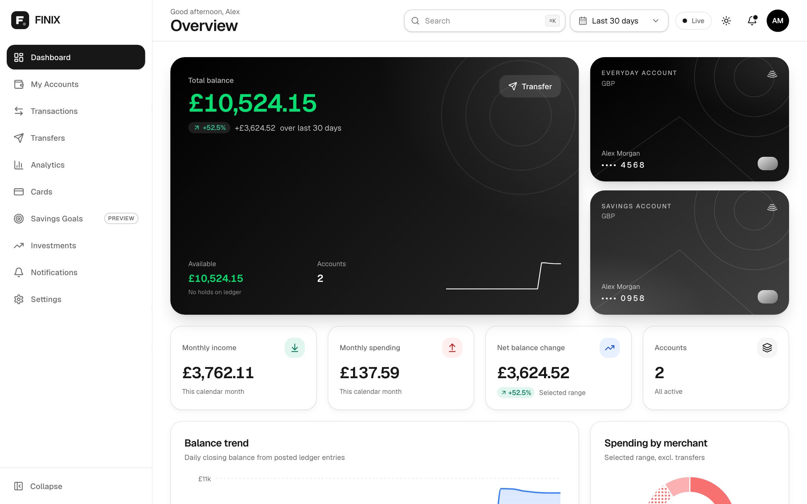
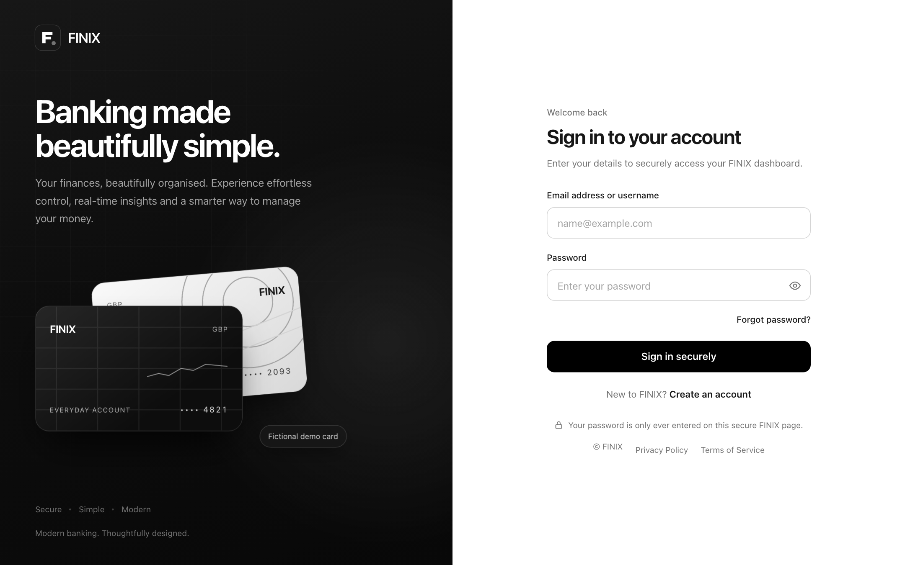
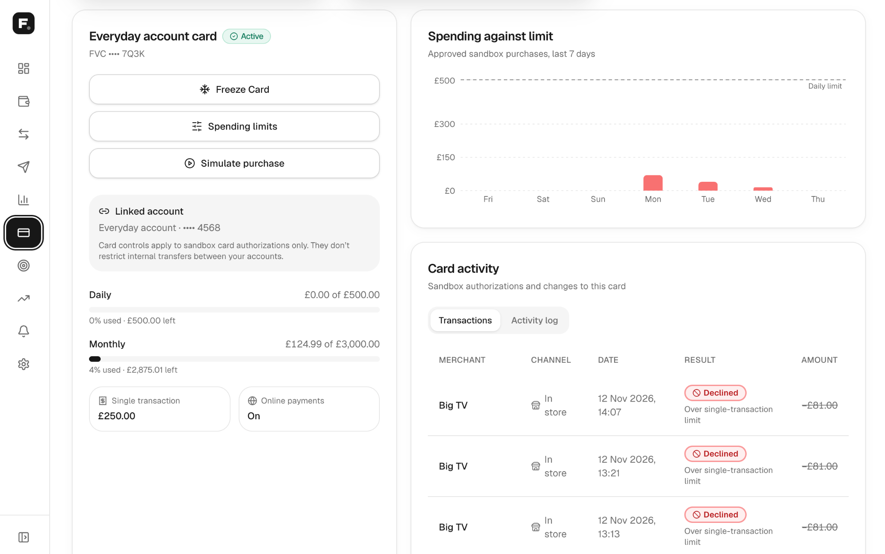
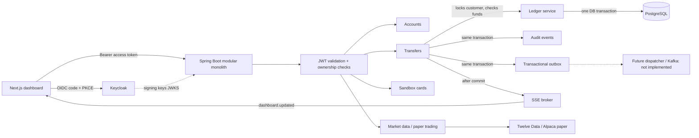

<div align="center">

# FINIX — Core Banking Platform

**A modern core banking development sandbox: double-entry GBP ledger, Keycloak authentication, sandbox cards and a premium Next.js dashboard.**

[](https://github.com/domwokorach/Core-Platform/actions/workflows/ci.yml)


</div>

> **FINIX is not a licensed bank and is not a production-ready financial service.** All customers, balances, cards and transactions are fictional. No real payments, card issuing, KYC/AML or regulated activity are implemented. The CI badge reflects the real workflow in [`.github/workflows/ci.yml`](.github/workflows/ci.yml); it can only turn green once GitHub Actions is able to run for this account.

## Screenshots

> Screenshots show local development features with fictional data. Card authorisations are simulated. No real financial transactions, credentials or customer details are represented.

### Dashboard



### Sign in — premium split-screen authentication

The FINIX sign-in experience features a black brand hero, fictional card artwork and a clean authentication form, hosted by Keycloak.



### Cards — spending limits and activity

The Cards page includes sandbox card controls, daily and monthly spending limits, spending analytics and a card activity table.



## Highlights

* **Ledger-backed banking:** balances derived from immutable, balanced double-entry journals in PostgreSQL; GBP only, integer pence.
* **Safe internal transfers:** one database transaction, customer-level locking, mandatory idempotency keys, audit events.
* **Keycloak SSO:** OIDC Authorization Code + PKCE, FINIX-themed sign-in and registration with e-mail verification, JWT validation in Spring Security.
* **Sandbox cards:** freeze, limits and simulated authorisations (no card numbers, no ledger postings).
* **Real-time updates:** post-commit Server-Sent Events.
* **Developer experience:** one-command Docker stack, generated local secrets, OpenAPI, Playwright and Testcontainers test suites.

## Documentation

[Development Rules](RULE.md) · [Design System](DESIGN.md) · [Risk Register](RISK.md) · [Security Policy](SECURITY.md) · [Licensing](LICENSE.md) · [Copyright](COPYRIGHT.md) · [Contributing](CONTRIBUTING.md) · [Roadmap](ROADMAP.md) · [Changelog](CHANGELOG.md)

## About this project

FINIX is a **modular-monolith banking development sandbox**: customer accounts, Keycloak authentication, ledger-backed balances, internal GBP transfers, transaction history, sandbox virtual cards and real-time dashboard updates, with an optional market-data and paper-trading integration. `preview.html` is a standalone visual mock-up (no dependencies; sample data, never calls the API).

## Contents

1. [Technology stack](#technology-stack) · 2. [Architecture](#architecture) · 3. [Project structure](#project-structure) · 4. [Installation requirements](#installation-requirements) · 5. [Run with Docker](#run-with-docker) · 6. [Local development](#local-development) · 7. [Environment variables](#environment-variables) · 8. [Authentication](#authentication) · 9. [API reference](#api-reference) · 10. [Banking functionality](#banking-functionality) · 11. [Testing](#testing) · 12. [Troubleshooting](#troubleshooting) · 13. [Project limitations](#project-limitations) · 14. [Documentation](#documentation)


## Technology stack

| Layer | Technology | Purpose in FINIX |
| --- | --- | --- |
| Frontend | Next.js 16 (App Router), React 19, TypeScript (strict) | Dashboard, sign-in entry points, route protection |
| UI | Tailwind CSS 4, Radix-based shadcn/ui-style components, Lucide icons, Motion for React | Design system ([DESIGN.md](DESIGN.md)), animation |
| Data/UI state | TanStack Query and Table, React Hook Form + Zod, Recharts, next-themes | Server state, forms/validation, charts, light/dark theme |
| Backend | Java 21, Spring Boot 3.5, Spring Security (OAuth 2.0 resource server) | REST API, JWT validation, ownership checks |
| Identity | Keycloak 26 (OIDC / OAuth 2.0, Authorization Code + PKCE) | Sign-in, registration, e-mail verification, token issuance |
| Database | PostgreSQL 16, Flyway | Ledger, accounts, transfers, audit, outbox, cards |
| Realtime | Server-Sent Events | Post-commit "something changed" notices |
| API docs | springdoc OpenAPI / Swagger UI (dev profile) | Interactive API explorer |
| Containers | Docker, Docker Compose, Mailpit (dev mail catcher) | Local and full-stack runs |
| Testing | JUnit 5 + Testcontainers, Playwright (+ axe) | Backend integration/unit tests, browser tests |
| CI | GitHub Actions (`.github/workflows/ci.yml`) | Typecheck, build, Playwright, `mvn test` |
| Infra scaffolding | Terraform (ECR repositories + CloudWatch log group only) | Starting point, **not** a deployment |
| Observability | Actuator, Micrometer/Prometheus; optional Prometheus + Grafana | Health and metrics |
| Optional integrations | Twelve Data (market data), Alpaca **paper** trading, Logo.dev (merchant logos) | Investments page, logos; all optional |

## Architecture



* **Frontend (Next.js).** Holds OIDC tokens in the browser's `sessionStorage` (public PKCE client), renews them with the refresh token, guards every banking route, and talks only to the FINIX API. It never computes or edits balances.
* **Backend (Spring Boot).** Stateless; validates every Bearer token and scopes every query to the token's `sub`. Business rules live in services (`LedgerService`, `TransferService`, `CardService`, `MarketDataService`); controllers stay thin.
* **Keycloak.** The only identity provider and the only place passwords are entered. FINIX has no password database.
* **PostgreSQL.** The financial source of truth, protected by constraints and triggers (below).
* **Ledger.** **Authoritative.** There is no mutable `balance` column: a balance is `SUM(ledger_entries.amount_minor)` for the account. Journals are balanced (zero-sum, single currency, at least two non-zero entries) and **immutable** (database triggers reject UPDATE/DELETE on journals, entries, transfers and audit events).
* **Transactional outbox.** Each transfer writes an `outbox_events` row in the same transaction. **No dispatcher exists yet**, so nothing consumes these rows.
* **SSE.** After a transfer commits, open streams of the owning customer receive `dashboard.updated` (no balances). In-process only; not durable ([details](#real-time-updates-sse)).
* **Optional providers.** Market data and paper trading are fetched server-side so keys never reach the browser.

## Project structure

```text
finix-core-banking/
├── README.md  RULE.md  DESIGN.md  RISK.md  SECURITY.md  LICENSE.md  COPYRIGHT.md
├── docker-compose.yml          postgres, keycloak, mailpit (+ monitoring profile)
├── docker-compose.full.yml     overlay adding backend and frontend containers
├── .env.example                documented template (real .env is git-ignored)
├── preview.html                standalone visual mock-up
├── backend/                    Spring Boot (Java 21, Maven)
│   └── src/main/java/com/finix/banking/
│       ├── accounts/  ledger/  transfers/  cards/  merchants/   banking modules
│       ├── market/  trading/                                     optional integrations
│       ├── auth/       first-sign-in customer provisioning filter
│       ├── api/  events/  config/                                HTTP, SSE, security/OpenAPI
│   └── src/main/resources/db/
│       ├── migration/  V1 core schema · V3 GBP policy · V4 cards  (all environments)
│       └── demo/       V2 / V5 fictional seed data (dev profile only)
├── frontend/                   Next.js app
│   ├── app/                    routes: (dashboard)/*, login, register, auth/callback, api/demo/*, privacy, terms
│   ├── components/             ui, auth, banking, cards, charts, dashboard, layout, market, transactions
│   ├── hooks/ providers/ lib/ types/   queries, auth/live providers, helpers, typed contracts
│   ├── lib/server/             server-only code (development demo sign-in)
│   └── tests/                  Playwright specs
├── infra/
│   ├── keycloak/               finix-realm.json (dev realm), themes/finix, themes/finix-dev
│   ├── observability/          Prometheus and Grafana config
│   └── terraform/              ECR + CloudWatch starter only
├── scripts/                    setup-env.sh, rotate-secret.sh, reset-dev-db.sh
└── .github/workflows/ci.yml
```

## Installation requirements

| Tool | Needed for | Notes |
| --- | --- | --- |
| Git | Cloning | All platforms |
| Docker Desktop (macOS/Windows) or Docker Engine + Compose plugin (Linux) | Running the stack, Testcontainers | Compose v2 (`docker compose`) |
| Java 21 + Maven 3.9+ | Backend outside Docker, `mvn test` | Temurin 21 is what CI uses |
| Node.js 22 + npm | Frontend outside Docker, tests | |
| OpenSSL | `scripts/setup-env.sh` | Preinstalled on macOS and most Linux distributions |
| Bash | Setup scripts | macOS/Linux native; on **Windows use WSL 2 or Git Bash** (the scripts are Bash, not PowerShell) |

Free ports: **3000** (web), **8080** (API), **8081** (Keycloak), **5433** (PostgreSQL, published on 5433 so it does not clash with a local 5432), **8025** (Mailpit UI), optionally 9090/3001 (Prometheus/Grafana).

## Run with Docker

```bash
# 1. Generate secrets once. Creates the git-ignored .env and frontend/.env.local; never overwrites existing values.
bash scripts/setup-env.sh

# 2. Build and start everything
docker compose \
  -f docker-compose.yml \
  -f docker-compose.full.yml \
  up --build -d

# 3. Check services
docker compose -f docker-compose.yml -f docker-compose.full.yml ps

# 4. Verify Keycloak discovery and the API
curl -f http://localhost:8081/realms/finix/.well-known/openid-configuration
curl -f http://localhost:8080/actuator/health
```

| Service | URL | Notes |
| --- | --- | --- |
| Web (Next.js, production build) | http://localhost:3000 | |
| API (Spring Boot, `dev` profile) | http://localhost:8080 | Swagger UI at `/swagger-ui.html` in the dev profile |
| Keycloak | http://localhost:8081 | Admin console `/admin`, user `admin`, password = `KC_BOOTSTRAP_ADMIN_PASSWORD` in `.env` |
| PostgreSQL | `127.0.0.1:5433` | User/database from `.env` |
| Mailpit | http://localhost:8025 | Catches Keycloak verification and reset e-mails |

* **Startup order** is enforced by health checks: PostgreSQL and Keycloak must be healthy before the API starts, and the API before the web container.
* **Logs:** `docker compose -f docker-compose.yml -f docker-compose.full.yml logs -f backend` (or `frontend`, `keycloak`, `postgres`).
* **Stop:** `docker compose -f docker-compose.yml -f docker-compose.full.yml down` keeps your data. Removing volumes (`down -v`) deletes the database and Keycloak users: do not do it unless you intend to.
* **The browser-facing URLs are baked into the web image at build time** (`NEXT_PUBLIC_*` build arguments, see [Environment variables](#environment-variables)). Change them and rebuild.
* **Hostnames and the issuer.** Keycloak is pinned to the public issuer `http://localhost:8081/realms/finix`. The API validates that exact issuer but fetches signing keys over the container network (`OIDC_JWKS_URI`). Issuer validation is never relaxed.
* **Persistence.** Banking data lives in the `finix_pg` volume and Keycloak's development database (registered users) in `finix_kc`. The Keycloak realm file is imported **only into an empty Keycloak database**; later changes to `infra/keycloak/finix-realm.json` must be applied through the admin console or `kcadm.sh`.
* **Development themes.** The development realm uses the `finix-dev` Keycloak theme (adds a credentials helper card, local only). See [Development account preview](#development-account-preview-on-the-sign-in-page).

## Local development

Run only the dependencies in Docker and the apps on your machine:

```bash
bash scripts/setup-env.sh                      # once
docker compose up -d postgres keycloak mailpit # dependencies

# Terminal 1: API (the dev profile also loads fictional demo data via Flyway)
cd backend
set -a; . ../.env; set +a                      # exposes POSTGRES_PASSWORD etc. to the API
mvn spring-boot:run -Dspring-boot.run.profiles=dev

# Terminal 2: web app
cd frontend
npm install
npm run dev                                    # http://localhost:3000
```

The development realm contains one fictional customer, `alex` (the password is in `infra/keycloak/finix-realm.json` and on the development sign-in card). Its two GBP accounts end in **4568** and **0958**.

* Use `http://localhost:3000` (not `127.0.0.1`): the realm registers only that callback, and the app redirects to `NEXT_PUBLIC_APP_ORIGIN` when started elsewhere.
* `scripts/reset-dev-db.sh` **deletes** the local PostgreSQL volume and reseeds fictional data. It asks for confirmation; never use it on data you want to keep.

## Environment variables

| File | Committed? | Read by | Contents |
| --- | --- | --- | --- |
| `.env.example` (root, `frontend/.env.example`) | Yes | Humans | Names and safe placeholders only |
| `.env` (root) | **No** (git-ignored) | Docker Compose; your shell for the API | Generated secrets and backend settings |
| `frontend/.env.local` | **No** | Next.js | Browser-public `NEXT_PUBLIC_*` values only |

Root `.env` (created by `scripts/setup-env.sh`; secrets are random 256-bit values and are never printed):

| Variable | Purpose |
| --- | --- |
| `POSTGRES_DB`, `POSTGRES_USER`, `POSTGRES_PASSWORD` | PostgreSQL initialisation and API credentials (`DB_*` in the API) |
| `KC_BOOTSTRAP_ADMIN_USERNAME`, `KC_BOOTSTRAP_ADMIN_PASSWORD` | Keycloak administrator (applies when Keycloak's database is first created) |
| `FINIX_SESSION_SECRET` | Generated and reserved for a future server-side session; **nothing reads it today** |
| `JWT_ISSUER_URI`, `JWT_JWKS_URI`, `JWT_AUDIENCE`, `KEYCLOAK_CLIENT_ID`, `KEYCLOAK_REALM`, `APP_ALLOWED_ORIGIN`, `SPRING_PROFILES_ACTIVE` | Mapped by Compose to the API's `OIDC_ISSUER_URI`, `OIDC_JWKS_URI`, `OIDC_AUDIENCE`, `OIDC_CLIENT_ID`, `APP_ALLOWED_ORIGIN` |
| `TWELVE_DATA_API_KEY`, `TWELVE_DATA_CREDITS_PER_MINUTE`, `MARKET_DATA_REALTIME_ENTITLED` | Optional market data (backend only) |
| `ALPACA_API_KEY_ID`, `ALPACA_API_SECRET_KEY` | Optional Alpaca **paper** trading (backend only; the host is fixed to the paper endpoint in code) |
| `LOGO_DEV_TOKEN` (or `NEXT_PUBLIC_LOGO_DEV_TOKEN`) | Logo.dev **publishable** key (`pk_…`), passed to the web image build |

`frontend/.env.local` (browser-public; **never put a secret in a `NEXT_PUBLIC_` variable**):

| Variable | Default | Purpose |
| --- | --- | --- |
| `NEXT_PUBLIC_APP_ORIGIN` | `http://localhost:3000` | Registered callback origin |
| `NEXT_PUBLIC_API_BASE_URL` | `http://localhost:8080` | API base URL |
| `NEXT_PUBLIC_OIDC_AUTHORITY` | `http://localhost:8081/realms/finix` | Keycloak realm URL (must equal the token issuer) |
| `NEXT_PUBLIC_OIDC_CLIENT_ID` | `finix-web` | Public OIDC client |
| `NEXT_PUBLIC_LOGO_DEV_TOKEN` | empty | Logo.dev publishable key; empty means neutral icons |
| `NEXT_PUBLIC_VISA_BRANDING_APPROVED` | `false` | Shows Visa artwork only if you hold the rights |
| `NEXT_PUBLIC_DEMO_MODE` | unset | Test-only signed-out sample-data view |
| `FINIX_DEMO_AUTH` (server variable, not public) | unset | Development-only demo sign-in; ignored by production builds |

Rotation and recovery are documented under [Secrets and environment](#secrets-and-environment).

## Authentication

Keycloak (realm `finix`, public client `finix-web`) is the sole identity provider. The flow is OAuth 2.0 **Authorization Code with PKCE (S256)**; the API accepts only Keycloak **access tokens** (never ID tokens).

| Step | What happens |
| --- | --- |
| Entry | Any protected page without a session redirects to `/login?returnTo=<page>`; `returnTo` accepts only known application sections |
| Login | `/login` starts the OIDC request (fresh `state`, `nonce`, PKCE verifier/challenge each time). The FINIX-themed Keycloak page is the only credential form |
| Callback | `/auth/callback` validates state, nonce, issuer, audience and expiry, then redirects to the validated `returnTo` |
| Registration | `/register` (or "Create an account") opens Keycloak's registration page; see [Registration](#registration-self-service) |
| API access | `Authorization: Bearer <access token>`; Spring Security checks signature (Keycloak JWKS), issuer, expiry/not-before, authorised client (`azp` = `finix-web`) and audience `finix-api` |
| Ownership | Every query is scoped to the token `sub`; `customers.oidc_subject` is `UNIQUE` |
| Renewal | Refresh-token renewal in the browser; a rejected token (401) ends the session and shows an expired-session message instead of auto-restarting sign-in (prevents redirect loops) |
| Expired login attempt | Keycloak hands back to FINIX, which offers a fresh sign-in (new state/nonce/PKCE) |
| Logout | Ends the Keycloak session and returns to `/login?signedOut=1` |

Keycloak message pages (reset password, verification, errors) use the same FINIX theme. Realm timeouts: 30 minutes to complete a login, 15 minutes per login action, 60 seconds for the code exchange.

### Registration (self-service)

* **One system.** `/register` (and the *Create an account* link on the sign-in page) starts the same Authorization Code + PKCE flow against Keycloak's registrations endpoint. The FINIX-themed Keycloak page (`infra/keycloak/themes/finix/login/register.ftl`) is the only place a password is typed; there is no FINIX password API.
* **Fields and policy.** First name, last name, email (used as the username for new accounts), password and confirmation. The password policy lives in the realm (`length(10) and notUsername and notEmail`); the page's guidance reads the same number from `theme.properties` (`passwordMinLength`). The strength meter is advice only.
* **Terms.** `termsAccepted` is a required attribute in the realm's user profile, so the server rejects a registration without it (it is never pre-checked) and the acceptance is stored on the user. The seeded demo user is pre-marked.
* **Email verification** is required. In development Keycloak sends through **Mailpit**, a mail catcher at http://localhost:8025 (nothing leaves your machine); open the message there to verify. An unverified identity cannot sign in to FINIX.
* **Customer profile.** On the first API call with a verified token, `CustomerProvisioningFilter` links the Keycloak `sub` to exactly one customer row (UNIQUE `oidc_subject`, `ON CONFLICT DO NOTHING`). The new customer has no accounts, so no one else's data is reachable. Opening accounts for new customers is not implemented.
* **Persisted Keycloak data.** The compose file keeps Keycloak's dev database in the `finix_kc` volume, so registered users survive container recreation. `--import-realm` only imports a realm that does not exist yet: after changing `infra/keycloak/finix-realm.json` apply the change in the admin console or recreate the volume (this deletes registered dev users, never banking data).
* Duplicate emails are reported plainly ("already exists"), which Keycloak's registration form necessarily reveals; protect it with rate limiting/CAPTCHA before going public.

### Secrets and environment

`bash scripts/setup-env.sh` creates (or completes) the git-ignored root `.env` and `frontend/.env.local`:

| Value | Where | Notes |
|---|---|---|
| `POSTGRES_PASSWORD`, `KC_BOOTSTRAP_ADMIN_PASSWORD`, `FINIX_SESSION_SECRET` | root `.env` (mode 600) | independent `openssl rand -hex 32` values (256 bits). Never printed. |
| `POSTGRES_DB/USER`, `KC_BOOTSTRAP_ADMIN_USERNAME`, `JWT_ISSUER_URI`, `JWT_JWKS_URI`, `JWT_AUDIENCE`, `APP_ALLOWED_ORIGIN`, `KEYCLOAK_*`, `SPRING_PROFILES_ACTIVE` | root `.env` | non-secret configuration mapped to Docker Compose and Spring (`OIDC_*`, `DB_*`) |
| `NEXT_PUBLIC_*` | `frontend/.env.local` | browser-public only; the script refuses to leave secret-looking names there |

* **Existing values are preserved** byte-for-byte (your API keys stay), a second run changes nothing, and files are replaced atomically.
* **JWTs.** Keycloak issues and signs them with its own keys; there is no `JWT_SECRET`. Spring Boot's resource server verifies the signature against Keycloak's JWKS, plus issuer, expiry/not-before, authorised client (`azp`) and API audience (`finix-api`); the customer is identified by the stable `sub` and every query is scoped to it. `JWT_ISSUER_URI` must equal the token `iss` (the browser-facing URL); `JWT_JWKS_URI` is only where the keys are fetched from inside Docker.
* **`FINIX_SESSION_SECRET`** is reserved for a server-side session (BFF). FINIX currently keeps tokens in the browser's `sessionStorage` (PKCE public client), so nothing reads it yet. There is no confidential OAuth client, so no client secret exists.
* **Existing Postgres volume.** A database keeps the password it was created with. After the first setup on a machine with data, run `bash scripts/setup-env.sh --apply-db-password` (Postgres running): it runs `ALTER USER` and does not touch data. Setup never deletes volumes.
* **Rotation (explicit only):** `bash scripts/rotate-secret.sh postgres | keycloak-admin | session`. `postgres` alters the live database user, updates `.env` atomically and restarts the containerised API (restart a locally run API yourself). `keycloak-admin` changes the admin password through the admin CLI. `session` replaces `FINIX_SESSION_SECRET` (existing sessions signed with the old one become invalid).
* **If a secret ever reaches Git,** rotate it first (above), then remove it from history (`git filter-repo`) and force-push only after informing collaborators; treat the old value as compromised regardless.
* **Production:** use a secret manager (not `.env`), HTTPS, `Secure` cookies and a non-dev Spring profile with the real issuer URL. This `.env` flow is for local development only.

### Development demo sign-in (local UI demos only)

The demo account (`demo@gmail.com`; the password is supplied by the project owner, not documented here) opens a **fictional** FINIX session for UI demonstrations. It is not authentication and not a bypass:

* **Off by default and development-only.** It exists only when the Next.js server runs in development **and** `FINIX_DEMO_AUTH=true` is set in its environment (a server-side variable; never `NEXT_PUBLIC_*`). Production builds, the Docker image and any dev server without the flag answer `404` on `/api/demo/*` and show only Keycloak sign-in.
  ```bash
  cd frontend && FINIX_DEMO_AUTH=true npm run dev     # then open http://localhost:3000/login (stop the Docker web container first, it owns port 3000)
  ```
* **Server-side check.** `POST /api/demo/login` compares against a SHA-256 digest held in server-only code (`frontend/lib/server/demo-auth.ts`); the password is not in any client bundle, browser storage or log. Failed attempts are throttled and a successful one resets the counter.
* **Session.** A signed (HMAC), HttpOnly, SameSite=Strict, two-hour cookie. No Keycloak token is ever created, `sessionStorage` holds nothing, and the per-process signing key means demo cookies die with the dev server.
* **Data.** The UI shows the static fictional fixtures (`frontend/lib/demo-data.ts`: Demo User, GBP, •••• 4568 and •••• 0958). A demo session makes **no** calls to the Spring API; if the cookie reaches the API (cookies ignore ports) Spring Security sees an anonymous request and returns 401, so ledger postings, transfers, cards and other customers' data are unreachable. Transfers in this mode are previews only.
* **Indicator.** A "Development Demo" notice stays visible on the login page and throughout the app; sign out clears the cookie.
* Keycloak sign-in stays available on the same page ("Continue with secure sign-in").

### Development account preview on the sign-in page

The Keycloak sign-in page shows a **Development Account** card (the fictional development user, with copy buttons, "Use demo credentials") in local development only. It is not a second sign-in: the button only fills the real Keycloak form.

* **Where it lives.** In the separate child theme `infra/keycloak/themes/finix-dev` (selected by the dev realm's `loginTheme`, mounted only by the dev `docker-compose.yml`). The shipped theme `infra/keycloak/themes/finix` contains an empty placeholder and **no credentials**; deploy only that one, with `loginTheme=finix`, to staging/production.
* **Three guards.** The dev theme must be active (`devCredentialsPreview=true` in its properties, a server-side setting), the page must be served from `http://localhost:` or `http://127.0.0.1:`, and the credentials come only from the dev theme's properties, never from a client bundle (a test scans the shipped theme and all Next.js build output for the password).
* **Switching it off locally:** `kcadm.sh update realms/finix -s loginTheme=finix` (the realm file is only imported on a fresh Keycloak database; see *Persisted Keycloak data* above).

## API reference

Interactive reference: Swagger UI at `http://localhost:8080/swagger-ui.html` (dev profile only; disabled by default in other profiles). The endpoints below were checked against the controllers in `backend/src/main/java`. **All `/api/**` endpoints require a valid Keycloak access token**; only `/actuator/health` is public.


| Method | Path | Description |
| --- | --- | --- |
| GET | `/api/dashboard` | Signed-in customer's balances, account cards, 50 latest ledger entries and monthly metrics |
| GET | `/api/accounts` | Owned active accounts with ledger-derived balances |
| GET | `/api/transfers` | Customer's latest 50 committed transfers (same shape as the POST receipt) |
| GET | `/api/transactions` | Customer's latest 50 ledger entries |
| POST | `/api/transfers` | Transfer between customer's own active same-currency accounts; requires `Idempotency-Key` header |
| GET | `/api/cards` | Sandbox virtual cards (status, masked reference, linked account, limits, spend so far; never balances or card numbers) |
| GET | `/api/cards/{cardId}` | One card (404 if it isn't yours) |
| POST | `/api/cards` | Issue a sandbox card `{accountId, cardType: EVERYDAY\|SAVINGS}`; requires `Idempotency-Key`; starts `PENDING_ACTIVATION` with £500 / £3,000 / £250 default limits |
| POST | `/api/cards/{cardId}/activate` \| `/freeze` \| `/unfreeze` | State machine `PENDING_ACTIVATION→ACTIVE⇄FROZEN`; repeating a command is a no-op; `BLOCKED`/`CLOSED` are terminal (409 `CARD_TERMINAL`) |
| PATCH | `/api/cards/{cardId}/limits` | Partial update of `dailyLimitMinor`, `monthlyLimitMinor`, `singleTransactionLimitMinor`, `onlineEnabled`. Ceilings £5,000 / £20,000 / £2,500, minimum £1.00, single ≤ daily ≤ monthly (422 `LIMIT_OUT_OF_RANGE`) |
| GET | `/api/cards/{cardId}/transactions` · `/activity` | Latest 50 sandbox authorizations · immutable audit trail of card changes |
| POST | `/api/cards/{cardId}/sandbox-authorizations` | Sandbox only (`app.cards.sandbox-authorizations-enabled`): runs a pretend purchase through the real authorization rules; records APPROVED/DECLINED, posts nothing to the ledger |
| GET | `/api/cards/events` | SSE: `card.created`, `card.activated`, `card.frozen`, `card.unfrozen`, `card.limits.updated`, `card.authorization.declined` (ids only) |
| GET | `/api/events/stream` | Server-Sent Events: `dashboard.updated` invalidation notices for the signed-in customer (Bearer header only) |
| GET | `/api/audit` | Customer's latest posted transfer audit events |
| GET | `/actuator/health` | Public health check |
| GET | `/actuator/prometheus` | Metrics; protect with network policy in a real deployment |
| GET | `/swagger-ui.html` | API explorer; protect in a real deployment |

Example authenticated transfer (use the OIDC access token returned by Keycloak; **do not** use an ID token as an API credential):

```bash
curl -X POST http://localhost:8080/api/transfers \
  -H "Authorization: Bearer $ACCESS_TOKEN" \
  -H "Content-Type: application/json" \
  -H "Idempotency-Key: example-transfer-0001" \
  -d '{
    "sourceAccountId":"11111111-1111-4111-8111-111111111111",
    "destinationAccountId":"22222222-2222-4222-8222-222222222222",
    "amountMinor":3540,
    "description":"Move into savings"
  }'
```

Additional endpoints that exist but are optional: `GET /api/paper/status`, `/api/paper/account`, `/api/paper/positions`, `/api/paper/orders` and `POST /api/paper/orders` (Alpaca **paper** trading, development only; see below).

**Not implemented (planned / proposed, do not rely on them):** an explicit customer-profile endpoint (a profile is created implicitly on the first authenticated call after e-mail verification, see below), external payments, FX, statements/exports, a persisted savings-goals API, an outbox dispatcher.

**First sign-in after registration.** `CustomerProvisioningFilter` links a *verified* Keycloak identity to exactly one customer row (`ON CONFLICT DO NOTHING` on the unique `sub`). A new customer owns **no accounts**; opening accounts for new customers is not implemented.

### Market data and paper trading (investments)

The **Investments** page and the dashboard watchlist show real quotes for AAPL, MSFT, NVDA and NFLX from [Twelve Data](https://twelvedata.com), fetched **by the Spring Boot API** (`backend/.../market`). The browser only talks to FINIX; the provider key never reaches client-side code. Without a key no prices are shown at all (there is no sample market data).

**Set up**

1. Create a free Twelve Data key at https://twelvedata.com (Basic plan: 8 API credits per minute, 800 per day).
2. Put it in the **backend** environment: `export TWELVE_DATA_API_KEY=...` before `mvn spring-boot:run`, or copy `.env.example` to `.env` (git-ignored). With the Docker full stack, `docker-compose.full.yml` passes these variables from `.env` to the API container (the images themselves contain no secrets). Do not use `NEXT_PUBLIC_*` for any of these.
3. Only if your plan includes real-time US data, also set `MARKET_DATA_REALTIME_ENTITLED=true`. The provider's quote response has no entitlement flag, so FINIX will not say **Live** unless you confirm this *and* the market is open *and* the quote timestamp is recent. Otherwise open-market quotes are labelled **Delayed**, closed-market quotes **End of day**, and quotes served from cache after a provider failure **Stale**.

| Method | Path | Description |
| --- | --- | --- |
| GET | `/api/market/quotes?symbols=AAPL,MSFT,NVDA,NFLX` | Quotes (native currency), freshness label, market status, indicative GBP estimate. Per-symbol failures are returned as `errors[]`, never as invented prices |
| GET | `/api/market/quotes/{symbol}` | One quote; structured `{code, message, retryAfterSeconds}` errors |
| GET | `/api/market/history/{symbol}?range=1D\|1W\|1M\|3M\|1Y` | Price history, oldest to newest, with exchange timezone |
| GET | `/api/market/status` | Provider configured?, credits remaining this minute, last success/error (no secrets) |
| GET | `/api/market/events` | SSE `market.updated` hints (no prices; clients re-read the REST endpoints). Authenticated by Bearer header only |

All endpoints require the same OIDC access token as the banking API. Symbols are validated against a server-side allow-list; nothing else reaches the provider.

**How the provider is used safely.** `TwelveDataClient` sends the key in the `Authorization: apikey …` header (never in a URL), with request timeouts, retry with exponential backoff for transient failures, and a per-minute credit limiter (default 8). Errors are detected from both the HTTP status and Twelve Data's documented `{code, message, status:"error"}` body (the docs do not say which HTTP status accompanies it); provider error text is never forwarded. `MarketDataService` caches (quotes 60 s while the market is open, 15 min when closed; history 15 min; FX 10 min) and **coalesces** concurrent requests into one provider call. If the provider fails, the last good value is served flagged **stale**; if there is none, the symbol shows "Price unavailable". Each symbol is fetched with its own `/quote` call (1 credit each, 4 per minute at most) because the docs do not define a multi-symbol response shape. Polling happens only while a client holds the SSE stream open. Twelve Data's WebSocket is **not** used: the Basic plan only includes a trial of it.

**Currencies.** These are US-listed securities, so prices are shown in their native **USD** (`US$200.00`), never relabelled as £. The optional GBP line is an **indicative** conversion using a real `USD/GBP` rate fetched from Twelve Data (`/exchange_rate`), shown with its source and timestamp and explicitly marked "not an executable price". If no rate can be fetched, the estimate is omitted. Banking balances remain GBP.

**Paper trading (development only).** Optional simulated trading uses [Alpaca paper trading](https://docs.alpaca.markets/us/docs/paper-trading). Set `ALPACA_API_KEY_ID` and `ALPACA_API_SECRET_KEY` to *paper* keys (Alpaca paper and live keys differ). `PaperConfig` refuses every host except `https://paper-api.alpaca.markets` (the live host is rejected by name), so live brokerage orders are impossible by construction. Orders are whole-share market/day orders of 1-100 shares for watchlist symbols only, with an idempotency key; everything is labelled **PAPER · SIMULATED**. It is a shared development sandbox account, has no access to the ledger, and never uses customer funds. Endpoints: `GET /api/paper/status|account|positions|orders`, `POST /api/paper/orders`.

**Not verified here:** the integration was built against the providers' published documentation and tested against local mock servers, with no live Twelve Data or Alpaca key available during development. Run it once with your own keys and check the Investments page against a provider's website before relying on it.

### Merchant logos (Logo.dev)

Transactions show real brand logos for verified merchants (Netflix, DKNY, Starbucks Coffee, KFC) via [Logo.dev](https://www.logo.dev/).

- **Setup:** put a Logo.dev **publishable** key (`pk_…`) in `frontend/.env.local` as `NEXT_PUBLIC_LOGO_DEV_TOKEN`. Publishable keys are designed for browser code; **never** use a secret key (`sk_…`) here (the app refuses to build a logo URL if it sees one). With no token, every merchant simply shows a neutral store icon. In the Logo.dev dashboard, restrict the key to your domains (`localhost` is allowed). Domain-restricted keys are validated against the `Referer` header, so the app keeps the browser's default referrer policy (only the origin, never a path, is sent).
- **Identification is server-side and exact.** `MerchantDirectory` (backend) normalises a transaction descriptor and matches it against an explicit alias list (`NETFLIX`, `NETFLIX.COM`, `DKNY`, `DONNA KARAN NEW YORK`, `STARBUCKS`, `STARBUCKS COFFEE`, `KFC`, `KENTUCKY FRIED CHICKEN`). There is **no substring matching**: "Starbucksy Ltd" or "KFC Fan Club" get no logo. `GET /api/transactions` and `/api/dashboard` now include `merchant {id,name,domain,category}` (or `null`) and `status: "COMPLETED"`; amounts stay integer pence in GBP.
- **Privacy:** the browser requests `https://img.logo.dev/{domain}?token=…&size=128&format=png&fallback=404` for the verified domain only. Descriptors, amounts, references and customer data are never sent. Logos are loaded directly by the browser, not proxied, as Logo.dev's fair-use policy requires.
- **Failure handling:** a 404 (no logo), 401/429, or network failure shows the neutral icon; the merchant name stays visible, no broken image is ever rendered, and nothing financial depends on a logo.
- **Attribution and trademarks:** Logo.dev's free plan requires a visible public link on commercial projects, so the app footer shows "Logos provided by Logo.dev" (and a trademark notice) whenever logos are enabled. Verify your public URL in the Logo.dev dashboard. Brand logos belong to their owners.

### Real-time updates (SSE)

`GET /api/events/stream` is a `text/event-stream` subscription. Once a transfer **commits**, every open stream of the owning customer receives a `dashboard.updated` event; the dashboard then re-reads `GET /api/dashboard`.

- **Authentication:** `Authorization: Bearer <access token>` only. The browser `EventSource` API cannot send headers, so the frontend uses `fetch` streaming (`frontend/lib/events.ts`). Tokens are never put in URLs; a request with `?access_token=` and no header gets 401. The same issuer / signature / expiry / `azp` / audience rules as every other endpoint apply, and the customer must have a banking profile (403 otherwise).
- **Scoping and lifetime:** streams are keyed by customer, never shared, and closed no later than the token's expiry. Limits: 5 streams per customer and 2,000 in total by default (`app.events.*`, HTTP 429 beyond that). Keepalive comments are sent every 20 s (`app.events.heartbeat-seconds`).
- **Events:** `stream.ready` (connection established), `dashboard.updated` (`eventId`, `reason`, `occurredAt`; **no balances or payment data**) and `: keepalive` comments.
- **Exactly when:** the event is published inside the transfer transaction and delivered after commit (`@TransactionalEventListener(AFTER_COMMIT)`). Rejected, conflicting, rolled-back and idempotent-replay requests never notify.
- **Client behaviour:** exponential backoff with jitter (1 s to 30 s); a full dashboard re-read after every connect and every event; a silence watchdog; no reconnect on HTTP 401/403 or after the token expires (the UI signs out). The status pill reads *LIVE · CONNECTED* only once `stream.ready` has arrived, otherwise *CONNECTING…*, *RECONNECTING…* or *OFFLINE*.
- **Not durable, by design:** notifications are not replayed. A client that was disconnected, or a notification lost between commit and delivery (for example a crash), is repaired by the re-read on reconnect.
- **Not implemented: multi-instance delivery.** Fan-out is in-process, so with more than one API instance a customer's stream only hears about transfers handled by the same instance. For production-scale deployments add an outbox relay (the `outbox_events` rows already commit with each transfer) publishing to a shared bus such as Kafka or Redis Streams, with each instance fanning bus messages out to its own streams, idempotent consumers, retry and poison-message handling, and lag metrics. None of that exists yet. Gauge `finix.sse.connections` and counters `finix.sse.events.sent` / `finix.sse.events.failed` are exposed through Actuator.
- Put proxies in front with response buffering disabled and an idle timeout above the heartbeat interval.

### Sandbox cards

Cards are **development-sandbox virtual cards**, not payment cards: no PAN/CVV is generated or stored (a card has a UUID and a non-numeric masked reference such as `FVC •••• 7Q3K`, deliberately distinct from the linked account's digits), they cannot be used at real merchants, and real issuing would need an authorised card provider with tokenisation and PCI DSS controls (`provider_reference` is reserved for that token). Tables: `cards`, `card_account_links`, `card_spending_limits`, `card_authorizations`, `card_activity_events` (V4; dev seed in `db/demo/V5`).

- **Enforcement is server-side.** `CardAuthorizationService` declines by card status, linked-account status, the online setting, and single/daily/monthly limits (Europe/London day and month); the card row is locked so concurrent authorizations can't overspend. Card limits do not restrict internal transfers.
- **Ledger untouched.** Issuing, freezing, limit changes and authorizations post no journals.
- **Security.** Ownership is enforced in every query (another customer's card is 404). Issuance is idempotent per customer + `Idempotency-Key` (key reuse with different details → 409); state commands are naturally idempotent. Activity and authorization rows are append-only (DB triggers). Per-customer rate limits (`app.cards.rate-limit.*`, 429 + `Retry-After`). Optional step-up: set `app.cards.step-up-max-age-seconds` > 0 and unfreezing/loosening limits require an OIDC `auth_time` that recent (403 `STEP_UP_REQUIRED`; the UI re-authenticates with `max_age=0`). Disabled by default in dev.
- **Real time.** Card events are sent only after commit, only to the owner's `/api/cards/events` streams, with ids only; the UI re-reads the cards on every event and reconnect.

## Banking functionality

### Currency (GBP)

FINIX is a **British pound sterling (GBP, £)** platform: `en-GB` formatting, `Europe/London` display time, amounts stored and calculated as **integer pence** (100p = £1). `formatGBP`/`money` in `frontend/lib/utils/format.ts` are display-only. The API rejects any non-GBP account or posting (`Currencies`, `LedgerService`, `TransferService`; cross-currency transfers are refused), and migration `V3` makes the database default new accounts to GBP and reject non-GBP ones. The dev seed is fictional GBP data.

**Existing USD dev data is never relabelled.** A local database seeded earlier with USD data fails Flyway's checksum on the edited seed; reset it with `scripts/reset-dev-db.sh` (deletes the local volume and reseeds GBP opening-balance journals). Converting real USD balances would need an approved conversion with a documented exchange rate and reconciliation, which this repo does not implement.

### Accounts and the ledger

* Account balances are **derived**: `SUM(ledger_entries.amount_minor)`; there is no mutable balance.
* Every posting is a journal of two or more non-zero entries that sum to zero in one currency. Constraint triggers verify balance at commit; other triggers reject UPDATE/DELETE of journals, entries, transfers and audit events. Account-currency checks also run in the database (`V3` makes GBP the only accepted currency for new rows).
* Only `LedgerService` posts journals. Controllers, the frontend and card/market modules never write balances.

### Transfers and idempotency

`POST /api/transfers` moves pence between the customer's **own** active GBP accounts. Rules enforced in `TransferService` inside one PostgreSQL transaction (the customer row is locked, which serialises concurrent debits):

| Check | Result |
| --- | --- |
| `Idempotency-Key` header missing or not 8–100 URL-safe characters | 400 |
| Same source and destination, amount outside 1–100,000,000 pence, non-GBP, cross-currency | 400 |
| Account not owned by the caller | not found / refused (ownership is part of every query) |
| Either account not active; insufficient available funds | 409 |
| Key already used for **different** details | 409 |
| Key replayed with the **same** details | the original receipt is returned and nothing is posted again |

### Audit logging and the outbox

* `audit_events` (append-only) records posted transfers; card changes have their own append-only activity trail. `GET /api/audit` exposes the caller's transfer audit events.
* `outbox_events` rows (`PENDING` → `PUBLISHED`/`FAILED`) are written atomically with each transfer. **Delivery is not implemented**: a dispatcher with leases, retries and poison-message handling is required before anything relies on them.

## Testing

| Suite | Command | Needs |
| --- | --- | --- |
| Backend unit + integration | `cd backend && mvn test` | Docker (Testcontainers starts PostgreSQL). Without Docker set `FINIX_TEST_DB_URL`, `FINIX_TEST_DB_USER`, `FINIX_TEST_DB_PASSWORD` for an empty PostgreSQL 16 |
| Frontend typecheck | `cd frontend && npm run typecheck` | Node 22 |
| Production build | `cd frontend && npm run build` | |
| Browser tests (all) | `cd frontend && npx playwright install chromium && npm run test:e2e` | Starts its own dev servers on 3000, 3100 and 3200; suites that need Keycloak/API/Mailpit **skip** when those are unreachable |

Playwright projects (`frontend/playwright.config.ts`), runnable individually with `npx playwright test --project=<name>`:

| Project | Covers | Needs |
| --- | --- | --- |
| `chromium` | UI, currency, monochrome design, legal pages, merchant logos, cards, market (sample-data mode on :3100) | Nothing external (some specs also use the stack) |
| `auth-desktop`, `auth-tablet`, `auth-mobile` | Sign-in flow, PKCE, returnTo safety, SSO, logout, expired attempts, callback errors, token-endpoint rules, API rejection of bad tokens | Keycloak :8081, API :8080, web on :3000 (the Docker stack) |
| `auth-ui` | Keycloak sign-in layout at six widths, keyboard, validation, development account card | Keycloak + web |
| `auth-register` | Registration layouts, validation, e-mail verification, duplicates | Keycloak, API, Mailpit :8025 |
| `auth-demo` | Development demo sign-in (starts a dev server on :3200 with `FINIX_DEMO_AUTH=true`) | Docker stack for the "disabled in production" checks |
| `logos-live` | Real Logo.dev logos on the live transactions page | Stack + internet + a Logo.dev key in the web build |

Backend notable tests: `JwtValidationTest` (issuer, audience, client, expiry, signature, `alg=none`), `CustomerProvisioningTest`, `TransferIntegrationTest`, `CardIntegrationTest`, `CardStepUpTest`, `EventStreamIntegrationTest`, `MarketHttpSecurityTest`, `MerchantDirectoryTest`. CI (`.github/workflows/ci.yml`) runs typecheck, build, `npm run test:e2e` and `mvn test`. It does not start Keycloak, the API or Mailpit, so the suites that need them are expected to skip there. **The CI workflow has not been re-verified against the newer `auth-*` and `logos-live` Playwright projects**; check it before relying on it.

## Observability

For local metrics:

```bash
docker compose --profile monitoring up -d prometheus grafana
```

Prometheus is at http://localhost:9090, Grafana at http://localhost:3001 (development login defined in `docker-compose.yml`, monitoring profile; change it before sharing the environment). The Prometheus scrape targets the locally running Spring API. For OpenTelemetry tracing, attach the OpenTelemetry Java agent to the backend runtime and configure `OTEL_SERVICE_NAME=finix-core-banking`, `OTEL_EXPORTER_OTLP_ENDPOINT=<collector-endpoint>` and `OTEL_TRACES_EXPORTER=otlp` in the **backend deployment environment**; a collector/trace backend is not bundled. Metrics are already exposed through Actuator/Micrometer.

## Troubleshooting

| Symptom | Likely cause and fix |
| --- | --- |
| `docker compose` says a variable is required (`POSTGRES_PASSWORD`, `KC_BOOTSTRAP_ADMIN_PASSWORD`) | `.env` is missing: run `bash scripts/setup-env.sh` |
| API cannot connect / "password authentication failed" after generating `.env` | An existing PostgreSQL volume keeps the password it was created with. With Postgres running: `bash scripts/setup-env.sh --apply-db-password` (runs `ALTER USER`, deletes nothing). To change it later use `scripts/rotate-secret.sh postgres` |
| Keycloak container exits with `AccessDeniedException` on `/opt/keycloak/data/h2` | The `finix_kc` named volume is root-owned. Fix ownership to UID 1000 (`chown 1000:0` on the volume root) without deleting it |
| Keycloak unhealthy but `curl` works | Health checks must send HTTP/1.1 with a `Host` header (Keycloak 26 returns 500 otherwise); the compose file already does |
| Keycloak admin login rejected | The admin password is only applied when Keycloak's database is first created. If `.env` contains duplicate `KC_BOOTSTRAP_ADMIN_*` lines, Compose uses the **last** one while the existing database keeps the first. Remove the duplicate and use `scripts/rotate-secret.sh keycloak-admin` to align them |
| Port already in use (3000, 8080, 8081, 5433, 8025) | Stop the other process or change the published port in the compose file; check with `lsof -nP -iTCP:<port> -sTCP:LISTEN` |
| "Your login attempt timed out" / `/login?error=timeout` | The Keycloak login page sat open longer than the login timeout, or Keycloak was recreated mid-flow. Choose **Try signing in again** (a new request is created) |
| `/login?error=callback`, "Cookie not found" | Callback state lost (restart/other tab) or cookies blocked; use `http://localhost:3000` consistently and retry |
| 401 from the API with a valid-looking login | Token issuer/audience/client mismatch. `JWT_ISSUER_URI` must equal the token's `iss` (browser-facing URL); the API must be able to reach `OIDC_JWKS_URI`; the token must carry audience `finix-api` and `azp=finix-web`. Never disable issuer validation |
| 403 "No banking profile" | The identity has no customer row: verify the e-mail (profile is created on the first verified call) |
| Redirect loop between FINIX and Keycloak | Should not occur: errors stop auto-start. If you see one, clear site data for `localhost`, check `NEXT_PUBLIC_*` match the registered client, and report it |
| Next.js dev server blocks resources / will not hydrate | Open `http://localhost:3000` (not a LAN address) or add the host to `allowedDevOrigins` in `next.config.ts`; `NEXT_DIST_DIR` separates parallel dev servers |
| Web shows no data / "Banking services are unavailable" | API down or unreachable (`curl localhost:8080/actuator/health`), or `NEXT_PUBLIC_API_BASE_URL` wrong for the build |
| Live indicator offline, HTTP 429 on `/api/events/stream` | Per-customer SSE connection cap (5); close other tabs/streams |
| No verification e-mail | Open Mailpit at http://localhost:8025; e-mails never leave the machine |
| Flyway checksum failure after the GBP change | An older database was seeded with different data; reset with `scripts/reset-dev-db.sh` (**deletes the local database volume**) |

## Project limitations

| Area | Status |
| --- | --- |
| **Implemented** | Keycloak OIDC + PKCE sign-in, registration with e-mail verification, JWT validation, ownership scoping, immutable double-entry ledger, GBP-only internal transfers with idempotency, audit events, sandbox virtual cards (no PAN/CVV, no ledger postings), SSE notices, merchant matching and logos, Docker full stack, CI build/test |
| **Development-only** | Seeded fictional customers and data (`db/demo`), the `dev` Spring profile (Swagger, Prometheus exposure), `finix-dev` Keycloak theme and credentials card, `FINIX_DEMO_AUTH` demo sign-in, Mailpit, default Keycloak realm file with a demo user |
| **Simulated / sandbox** | Cards (sandbox authorisations only), paper trading (Alpaca *paper*), market data (third-party quotes, never relabelled as GBP), all balances |
| **Planned / not built** | Outbox dispatcher and multi-instance event delivery, onboarding that opens accounts for new customers, external payments and FX, KYC/AML, fraud controls, statements, persisted savings goals, server-side session (BFF), API-wide rate limiting, security headers/CSP, vulnerability scanning in CI, backups and disaster recovery |
| **Production-readiness gaps** | See [SECURITY.md](SECURITY.md#10-production-readiness) and [RISK.md](RISK.md). In short: no regulatory authorisation, no compliance evidence, no secret manager, no TLS termination, no backup/restore procedure, no monitoring/alerting, Terraform covers only ECR repositories and a log group |

## Documentation

| Document | Contents |
| --- | --- |
| [Development Rules](RULE.md) | Architecture, Java, TypeScript, database, security and AI-agent rules |
| [Design System](DESIGN.md) | Brand, colour, typography, components, responsive and accessibility rules |
| [Risk Register](RISK.md) | Financial, authentication, data, infrastructure, API and compliance risks |
| [Licensing](LICENSE.md) | Licence status (**selection pending**) and third-party licences |
| [Copyright](COPYRIGHT.md) | Ownership placeholders, third-party and trademark notices |
| [Security Policy](SECURITY.md) | Vulnerability reporting, controls, secrets, incident response |
| [Terraform notes](infra/terraform/README.md) | What the AWS scaffolding does and does not provision |
